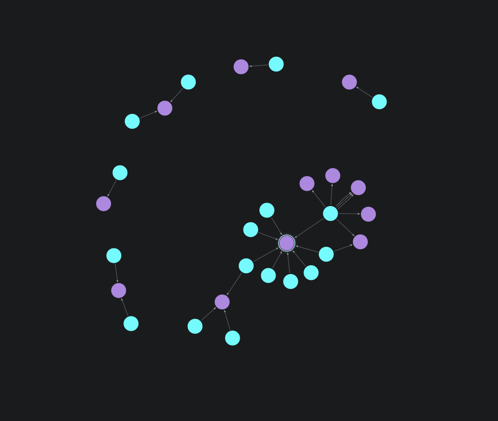

# MicrobeLinks GraphRAG

Gut microbes connected through metabolites in scientific literature. The prototype extracts evidence-backed links into a Neo4j graph, finds paths between two microbes, and cites the supporting passages. If the papers do not support a connection, it says so.

Built to learn: RAG, LLM calls, FastAPI, Neo4j, and graph algorithms.

## Layout

```
README.md
requirements.txt
scripts/          # pipeline code
  fetch_passages.py
  build_index.py
  extract_links.py
  load_neo4j.py
data/             # papers, passages, embeddings, links
docs/             # screenshots
```

## Setup

```bash
source .venv/bin/activate
# Neo4j Desktop: start a local DBMS first
```

## To do

- [x] choose papers — PMC522113, PMC1472403, PMC7702098
- [x] fetch papers and split into passages — `python scripts/fetch_passages.py`
- [x] build a RAG index — `.venv/bin/python scripts/build_index.py`
- [x] extract microbe–metabolite links with an LLM — `python scripts/extract_links.py`
- [x] load links into Neo4j — `NEO4J_PASSWORD='...' python scripts/load_neo4j.py`
- [ ] expose a FastAPI endpoint that takes two microbes
- [ ] search the graph for a path between them
- [ ] return an explanation with citations, or say no supported connection was found

## Progress

Neo4j graph from the three papers: **17 microbes**, **12 metabolites**, **26 relationships** (`PRODUCES` / `CONSUMES` / `CONVERTS`), each with a paper quote.


